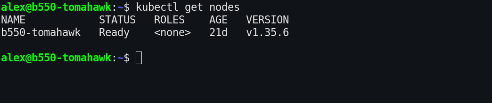
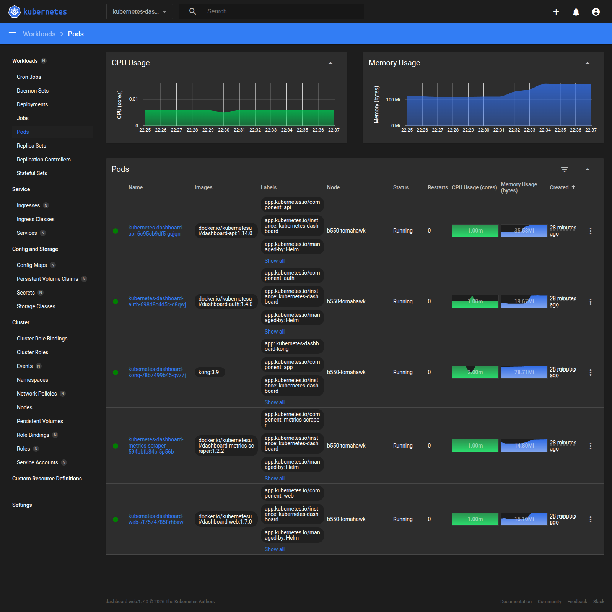

# Домашнее задание к занятию «Kubernetes. Причины появления. Команда kubectl»

**Стенд:** локальная машина с Arch Linux, hostname `b550-tomahawk`, внешний IP `192.168.50.225`.

| Параметр | Значение |
|---|---|
| ОС | Arch Linux, kernel `7.2.11-arch1-1` |
| MicroK8s | `v1.35.6`, revision `9072`, channel `1.35/stable` |
| kubectl | `v1.37.1` |
| Container runtime | `containerd://2.1.6` |
| Внешний IP узла | `192.168.50.225` |

---

## Задание 1. Установка MicroK8S

### 1.1. Установка MicroK8S

MicroK8S установлен из snap:

```bash
sudo snap install microk8s --classic
sudo usermod -aG microk8s "$USER"
sudo chown -R "$USER":"$USER" ~/.kube
```

На Arch Linux после установки проявилась особенность: сервис `snapd.apparmor` был выключен, поэтому `microk8s status` завершался ошибкой:

```text
missing profile snap.microk8s.microk8s.
Please make sure that the snapd.apparmor service is enabled and started
```

Профиль AppArmor создаётся при запуске `snapd.apparmor`. Исправление:

```bash
sudo systemctl enable --now snapd.apparmor
sudo snap restart microk8s
```

Проверка состояния кластера:

```bash
microk8s status --wait-ready
```

Фрагмент вывода:

```text
microk8s is running
high-availability: no
  datastore master nodes: 127.0.0.1:19001
  datastore standby nodes: none
addons:
  enabled:
    dashboard            # (core) The Kubernetes dashboard
    dns                  # (core) CoreDNS
    ha-cluster           # (core) Configure high availability on the current node
    helm                 # (core) Helm - the package manager for Kubernetes
    helm3                # (core) Helm 3 - the package manager for Kubernetes
    metrics-server       # (core) K8s Metrics Server for API access to service metrics
```

Версия MicroK8S:

```text
MicroK8s v1.35.6 revision 9072
```

Проверка узла:

```bash
microk8s kubectl get nodes
```

```text
NAME            STATUS   ROLES    AGE   VERSION
b550-tomahawk   Ready    <none>   21d   v1.35.6
```

### 1.2. Установка dashboard

Dashboard установлен штатным addon MicroK8S:

```bash
microk8s enable dashboard
```

Addon `dashboard` включён:

```text
dashboard            # (core) The Kubernetes dashboard
```

> Примечание: upstream-манифест `https://raw.githubusercontent.com/kubernetes/dashboard/v3.0.0-alpha1/aio/deploy/recommended.yaml` возвращает 404. В Kubernetes Dashboard v3 нет файла `aio/deploy/recommended.yaml`, установка выполняется через Helm-чарт. Addon MicroK8S устанавливает этот чарт (7.14.0) и все необходимые ресурсы.

Поды dashboard:

```bash
kubectl -n kubernetes-dashboard get pods -o wide
```

```text
NAME                                                    READY   STATUS    RESTARTS   AGE   IP            NODE
kubernetes-dashboard-api-6c95cb9df5-gqjqn               1/1     Running   0          23m   10.1.184.27   b550-tomahawk
kubernetes-dashboard-auth-698d8c4d5c-d8qwj              1/1     Running   0          23m   10.1.184.24   b550-tomahawk
kubernetes-dashboard-kong-78b7499b45-gvz7j              1/1     Running   0          23m   10.1.184.25   b550-tomahawk
kubernetes-dashboard-metrics-scraper-594bbfb84b-5p56b   1/1     Running   0          23m   10.1.184.26   b550-tomahawk
kubernetes-dashboard-web-7f7574785f-rhbxw               1/1     Running   0          23m   10.1.184.23   b550-tomahawk
```

Сервисы dashboard:

```bash
kubectl -n kubernetes-dashboard get svc
```

```text
NAME                                   TYPE        CLUSTER-IP       EXTERNAL-IP   PORT(S)    AGE
kubernetes-dashboard-api               ClusterIP   10.152.183.87    <none>        8000/TCP   23m
kubernetes-dashboard-auth              ClusterIP   10.152.183.131   <none>        8000/TCP   23m
kubernetes-dashboard-kong-proxy        ClusterIP   10.152.183.232   <none>        443/TCP    23m
kubernetes-dashboard-metrics-scraper   ClusterIP   10.152.183.65    <none>        8000/TCP   23m
kubernetes-dashboard-web               ClusterIP   10.152.183.179   <none>        8000/TCP   23m
```

Токен для входа в dashboard:

```bash
kubectl -n kube-system get secret microk8s-dashboard-token \
  -o jsonpath='{.data.token}' | base64 -d
```

Токен принадлежит service account `default` в namespace `kube-system`; в лабораторном кластере у него есть права cluster-admin:

```bash
kubectl auth can-i '*' '*' --as=system:serviceaccount:kube-system:default
```

```text
yes
```

### 1.3. Сертификат для внешнего IP

API-сервер MicroK8S использует сертификат:

```text
/var/snap/microk8s/current/certs/server.crt
```

Проверка сертификата:

```bash
openssl x509 -in /var/snap/microk8s/current/certs/server.crt \
  -noout -subject -issuer -dates -ext subjectAltName
```

Фрагмент вывода:

```text
subject=C=GB, ST=Canonical, L=Canonical, O=Canonical, OU=Canonical, CN=127.0.0.1
issuer=CN=10.152.183.1
notBefore=Oct 27 10:27:03 2026 GMT
notAfter=Oct 27 10:27:03 2027 GMT
X509v3 Subject Alternative Name:
    DNS:kubernetes, DNS:kubernetes.default, DNS:kubernetes.default.svc,
    DNS:kubernetes.default.svc.cluster, DNS:kubernetes.default.svc.cluster.local,
    IP Address:127.0.0.1, IP Address:10.152.183.1,
    IP Address:192.168.50.225, ...
```

Внешний IP `192.168.50.225` уже присутствует в SAN сертификата. За автоматическое добавление адресов интерфейсов отвечает маркер `#MOREIPS` в шаблоне:

```bash
sed -n '20,30p' /var/snap/microk8s/current/certs/csr.conf.template
```

```text
[ alt_names ]
DNS.1 = kubernetes
DNS.2 = kubernetes.default
DNS.3 = kubernetes.default.svc
DNS.4 = kubernetes.default.svc.cluster
DNS.5 = kubernetes.default.svc.cluster.local
IP.1 = 127.0.0.1
IP.2 = 10.152.183.1
#MOREIPS
```

Маркер `#MOREIPS` при генерации заменяется IP-адресами интерфейсов узла. В итоговом `csr.conf` появился внешний адрес:

```bash
grep -n 'IP.3' /var/snap/microk8s/current/certs/csr.conf
```

```text
27:IP.3 = 192.168.50.225
```

Поэтому отдельная перегенерация сертификата не потребовалась: сертификат уже выпущен для внешнего IP.

Если внешний IP изменится, его нужно добавить в секцию `[alt_names]` файла `csr.conf.template` и обновить именно серверный сертификат:

```bash
sudo microk8s refresh-certs --cert server.crt
```

> В инструкции указан `front-proxy-client.crt`, но это сертификат front-proxy/агрегации, а не сертификат API-сервера. Для подключения к API по внешнему IP используется `server.crt`.

---

## Задание 2. Установка и настройка локального kubectl

### 2.1. Установка kubectl

На Arch Linux kubectl установлен из системного репозитория:

```bash
sudo pacman -S --needed kubectl
```

Проверка:

```bash
kubectl version --client
```

```text
Client Version: v1.37.1
Kustomize Version: v5.8.1
```

Альтернативный способ — официальный бинарник Kubernetes:

```bash
curl -LO "https://dl.k8s.io/release/$(curl -L -s https://dl.k8s.io/release/stable.txt)/bin/linux/amd64/kubectl"
chmod +x kubectl
sudo install -m 0755 kubectl /usr/local/bin/kubectl
```

### 2.2. Настройка подключения к кластеру

Конфигурация MicroK8S сохранена в стандартный kubeconfig:

```bash
mkdir -p ~/.kube
microk8s config > ~/.kube/config
chmod 600 ~/.kube/config
```

Проверка контекста:

```bash
kubectl config get-contexts
```

```text
CURRENT   NAME       CLUSTER            AUTHINFO   NAMESPACE
*         microk8s   microk8s-cluster   admin
```

Адрес API-сервера:

```bash
kubectl config view --minify -o jsonpath='{.clusters[0].cluster.server}{"\n"}'
```

```text
https://192.168.50.225:16443
```

Проверка подключения:

```bash
kubectl get nodes
```

```text
NAME            STATUS   ROLES    AGE   VERSION
b550-tomahawk   Ready    <none>   21d   v1.35.6
```

Скриншот вывода `kubectl get nodes`:



### 2.3. Подключение к dashboard через port-forward

Запуск проброса порта на локальную машину:

```bash
kubectl -n kubernetes-dashboard port-forward \
  svc/kubernetes-dashboard-kong-proxy 8443:443
```

```text
Forwarding from 127.0.0.1:8443 -> 8443
Forwarding from [::1]:8443 -> 8443
```

Dashboard открывается по адресу:

```text
https://localhost:8443/
```

При первом открытии браузер показывает предупреждение о самоподписанном сертификате — для локального стенда это ожидаемо. После принятия сертификата нужно вставить токен, полученный командой выше, и нажать **Sign in**.

Проверка доступности:

```bash
curl -skI https://localhost:8443/ | head -n 1
```

```text
HTTP/2 200
```

> `microk8s dashboard-proxy` в MicroK8S 1.35 объявлен deprecated, поэтому используется стандартный `kubectl port-forward` к сервису `kubernetes-dashboard-kong-proxy`.

Скриншот dashboard (namespace `kubernetes-dashboard`, все пять подов в состоянии `Running`):



---

## Диагностика: почему dashboard сначала отдавал HTTP 500

При первом открытии dashboard вместо страницы возвращал HTTP 500. В логах Kong было:

```text
failed the initial dns/balancer resolve for 'kubernetes-dashboard-web'
with: failed to receive reply from UDP server 10.152.183.10:53: timeout
```

То есть dashboard не мог разрешить имя `kubernetes-dashboard-web` через CoreDNS (`10.152.183.10`).

### Проверка DNS

CoreDNS был запущен:

```bash
kubectl -n kube-system get pods -l k8s-app=kube-dns -o wide
```

```text
NAME                       READY   STATUS    RESTARTS   AGE   IP            NODE
coredns-78894c95f4-v2kkx   1/1     Running   48         21d   10.1.184.20   b550-tomahawk
```

Из network namespace самого CoreDNS DNS работал:

```text
nslookup kubernetes.default.svc.cluster.local 127.0.0.1
nslookup kubernetes.default.svc.cluster.local 10.1.184.20
```

Оба запроса возвращали `10.152.183.1`. Но из обычных подов запросы к `10.152.183.10:53` и напрямую к `10.1.184.20:53` завершались таймаутом. При этом:

- узел → pod работал;
- pod → узел работал;
- pod → pod не работал.

### Проверка Calico

Calico изначально использовал `IP_AUTODETECTION_METHOD=first-found` и выбрал VPN-интерфейс `amn0` с адресом `10.8.1.6`. Это было исправлено:

```bash
kubectl -n kube-system set env ds/calico-node \
  IP_AUTODETECTION_METHOD=interface=enp4s0
kubectl -n kube-system rollout status ds/calico-node
```

После перезапуска pod `calico-node-b8wd4` использует `192.168.50.225`. Это убрало VPN-интерфейс из pod-сети, но само по себе HTTP 500 не исправило.

### Корневая причина

На хосте одновременно используются nftables и iptables-legacy:

```text
iptables v1.8.13 (nf_tables)
```

Calico внутри pod работает через iptables-legacy. При этом в nftables-таблице `ip filter` (её использует Docker) цепочка `FORWARD` имела политику `DROP`:

```text
Chain FORWARD (policy DROP 51119 packets, 2310K bytes)
```

Пакеты между pod'ами проходят через `FORWARD`, поэтому принимались правилами Calico в legacy-таблицах, но затем отбрасывались nftables-политикой хоста. Трафик «узел ↔ pod» использует `INPUT`/`OUTPUT` и поэтому работал, а «pod ↔ pod» — нет.

### Исправление

Политика `FORWARD` в nftables переключена на `ACCEPT`:

```bash
sudo iptables-nft -P FORWARD ACCEPT
```

В стенде та же команда выполнена через временный pod `tcpdump` (образ `nicolaka/netshoot`) с `hostNetwork: true` и capability `NET_ADMIN`, чтобы не запрашивать sudo в неинтерактивной сессии:

```bash
kubectl exec tcpdump -- iptables-nft -P FORWARD ACCEPT
```

Проверка после исправления:

```text
Chain FORWARD (policy ACCEPT ...)
```

Сразу после этого DNS из pod'а начал работать:

```bash
kubectl run dnstest --image=busybox:1.36 --restart=Never -- sleep 300
kubectl exec dnstest -- nslookup \
  kubernetes-dashboard-web.kubernetes-dashboard.svc.cluster.local
```

```text
Server:    10.152.183.10
Address:   10.152.183.10:53

Name:      kubernetes-dashboard-web.kubernetes-dashboard.svc.cluster.local
Address:   10.152.183.179
```

Dashboard после этого отдал HTTP 200 и успешно авторизовался по токену.

> Важно: `iptables-nft -P FORWARD ACCEPT` изменил политику только в текущей сессии. После перезагрузки или перезапуска Docker правило может сброситься. Для постоянного стенда его нужно закрепить через systemd/nftables или согласованную настройку Docker и Calico. В лабораторной работе достаточно runtime-исправления, но в production такой подход требует отдельного анализа безопасности.

---

## Итог

- MicroK8S `v1.35.6` установлен и запущен, узел `b550-tomahawk` в состоянии `Ready`.
- Dashboard установлен, доступен через `kubectl port-forward` и авторизацию по токену.
- Сертификат API-сервера содержит внешний IP `192.168.50.225` в SAN.
- Локальный `kubectl` настроен на `https://192.168.50.225:16443`, команда `kubectl get nodes` работает.
- Приложены скриншоты `kubectl get nodes` и dashboard.
